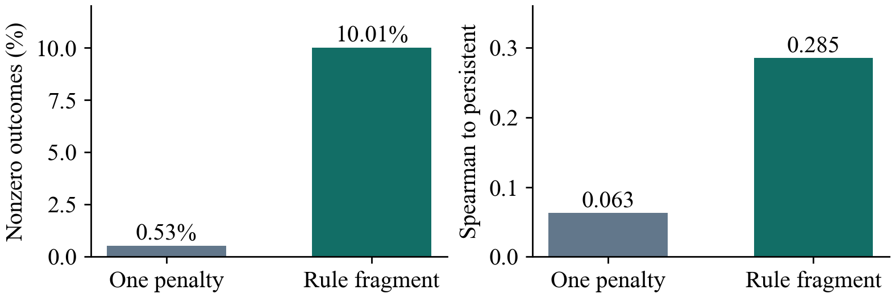
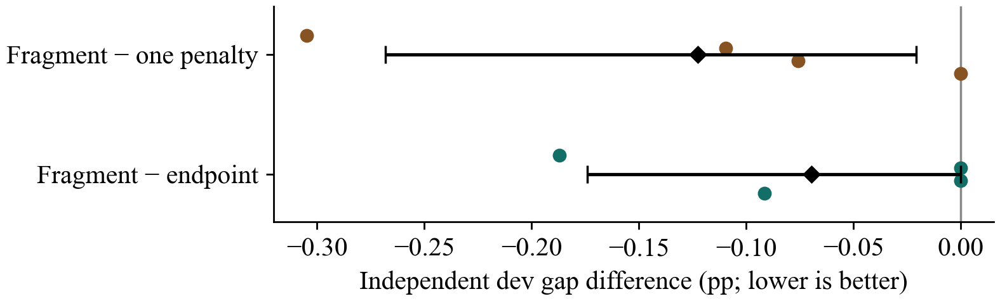

<!-- Page 1 -->
## Learning TSP Heuristic Programs from Search-State Values

Milestone: from edge actions to rule fragments

Hongye XU (72655146), Group G042 | CS5491 Artificial Intelligence | 19 November 2026

## 1. Question and contribution

Can search-state feedback help a frozen code language model discover better TSP heuristics? Endpoint route length provides a trustworthy selection signal, but gives little detail about a rule's decisions. Our original proposal learned values of individual penalty actions and supplied parent/child value differences to the generator. The milestone tests a more basic prerequisite: whether the measured intervention describes the object being modified, namely a repeatedly applied rule.

We contribute a matched-work rule-fragment intervention, an audited bank spanning 128 original instances, three trajectories and four search phases, and a controlled downstream discovery comparison. We separate feedback informativeness from useful program discovery. The work follows the minimum frozen-generator core requested in the proposal assessment; a new learned predictor or generator adaptation is not required to establish this comparison.

## 2. Search engine and program interface

We use Euclidean TSP50/100 data from the author training release [3]. Our single-edge GLS implementation follows the penalty idea in [1], alternating best-improvement 2-opt and an edge-penalty increment. Its cap is 200 sweep equivalents: 235,000/970,000 evaluated 2-opt deltas. Quality uses original continuous distances. Gap is 100(L/Lref − 1); supplied references are not certified continuous optima, so negative gaps are retained.

The model generates a single arithmetic priority h(d,p,mean_d,max_d,lam,progress,stagnation,best_ratio) for current-tour edges. The maximum-priority edge receives the penalty; conventional GLS uses d/(1+p). The solver, initialization, lambda rule and numerical language stay fixed. The 96-node AST permits only bounded numeric constants, arithmetic and whitelisted numerical functions. Features use the current state only, with no future branch labels or reference-tour information.

A strict full-function precursor had frequent bare-return responses (112/384 valid). Before inspecting either new dev result, we documented one uniform transport revision: prefill the function header and return prefix, then sample one expression line (128-token cap). Both batches remain public and unpooled. The precursor F−A was −0.0718 points [−0.2007,+0.0374], also inconclusive. No further rescue or outcome-based expansion was performed.

This is executable heuristic search, related to EoH [2], rather than a replication of its thought/code evolution. Deployment runs the selected arithmetic program without an LLM or neural critic. Only actual discovery and program-selection route quality can promote a program.

<!-- Page 2 -->
## 3. Matched interventions and data separation

At a saved penalty boundary s with remaining work R, all branches share state and RNG seed 71. Single applies h once, then standard GLS. Fragment applies h for floor(0.25R) deltas, then standard GLS. Persistent applies h throughout R. All end at the same total work cap and retain the best original-distance tour.

Define V_m(s,h)=100[L_std(s)−L_m(s,h)]/L_best(s). Feedback subtracts parent value from child value at the same state. Persistent outcomes are a diagnostic target, never model input; they describe continuation from s, not full-run generalization. The 25% fraction and 12 diagnostic rules were fixed before outcomes.

| Role | Original instances | Use |
| --- | --- | --- |
| Bank | 128 (64/size) | State feedback and diagnostics |
| Discovery | 32 (16/size) | Candidate endpoint selection |
| Program select | 32 (16/size) | Choose among four elites |
| Independent dev | 64 (32/size) | Evaluate frozen lineages |

The 256 previously unused originals (nominal value_train rows 577–704) were reserved and audited before outcomes; IDs and coordinate hashes are disjoint across roles. Each bank original follows standard, centered and soft-penalty trajectories, sampled after 10/30/50/70% work: 1,536 states. Feedback uses one predetermined state per original, balanced across policy/phase; all 128 contribute summaries, with two fixed-schedule examples.

## 4. Mechanism result: more conditional information

Nonzero outcomes rise from 82/15,360 (0.53%) to 1,538/15,360 (10.01%): a paired original-instance increase of 9.48 points (95% interval 7.79–11.26). Tie-aware sign agreement rises from 0.504 to 0.573 (increase 0.071, interval 0.056–0.087; 102 informative originals). All 56,832 branch tours reprice exactly; 3,072 standard/rescaling controls and 12 independent replays match. This establishes intervention fidelity, not improved discovery.

<!-- Page 3 -->
## 5. Does the feedback improve program discovery?

Frozen NF4 Qwen2.5-Coder-7B-Instruct [4], without adapters, receives endpoints alone (A), plus single-penalty feedback (P), or plus fragment feedback (F). Matched settings: seeds 1201–1204, standard parent, temperature 0.8/top-p 0.95/top-k 50, 32 outputs per lineage (384 total). Failures/duplicates consume budget; feedback compares the previous candidate with its actual parent.

Top-four unique discovery elites undergo program_select with three solver seeds; all 12 programs freeze before dev with five seeds. Seeds average within originals. Paired intervals jointly resample discovery repetitions and size-stratified originals. Success requires F−A≤−0.05 gap points and an upper 95% limit below zero.

| Method / fixed reference | Mean dev gap (%) |
| --- | --- |
| A: endpoints | 2.412 |
| P: one penalty | 2.465 |
| F: rule fragment | 2.342 |
| Standard GLS | 2.389 |
| Nearest neighbor | 23.557 |
| 2-opt | 3.757 |
| Manual: soft penalty | 2.154 |
| Manual: centered | 2.168 |
| Manual: phase centered | 2.171 |
| LEHD greedy | 0.568 |
| LEHD RRC10 | 0.091 |
| LKH3.0.6 (1000 trials) | -0.027 |

Table 1. Same 64 dev originals/five solver seeds; all four A/P/F discovery repetitions. All manual rules are reported. LKH/LEHD [5] use their own budgets. LKH rounds input at scale 10^6; tours are repriced continuously.

F−A=-0.0697 gap points [-0.1739,+0.0000]; F−P=-0.1225 [-0.2682,-0.0207]. This did not meet the success gate. Four discovery repetitions limit precision; 320 solves do not create more discovery runs.

<!-- Page 4 -->
## 6. Interpretation, engineering and cost

The expression-continuation study has 361/384 valid outputs. A/P/F produce sums of 38/31/24 unique programs and 22/24/13 distinct endpoint route vectors within their four lineages. These are within-lineage sums, not global unique counts. P/F receive a nonzero state comparison in 1/55 of 128 prompts. A richer diagnostic rule family therefore need not imply rich feedback along the generated search trajectories.

Three F lineages retain standard GLS; one selects 0.4d/(1+p)+0.6d·mean_d/max_d, an interpretable mixture that softens penalty suppression. Its dev improvement does not establish an independently repeated discovery. One F−A advantage instead avoids a dev regression of an A-selected program. The next experiment must control the common proposal pool as well as feedback.

On one rented RTX3090 24GB with 14 vCPUs/60GB RAM, the nested 192-state pilot took 53 s and the additional 1,344 states took 216 s. Mechanism preparation/measurement totaled 269 wall s and 2480 parent+waited-child CPU s, without counting the pilot twice. Strict/expression discovery took 1181/1149 wall s, 4312 combined CPU s; synchronized generation occupied 1012/911 s. Peak Torch allocation was 8.26 GiB. Input/output tokens were 382,146/14,987 and 456,294/11,606. Labels, CPU feedback, references, failures and reproduction costs have a separate ledger; matching output budgets does not equal matching compute.

On 16 prespecified originals with three serial repeats (576 solves across methods), native GLS takes 0.039/0.083 s for TSP50/100; the illustrated F rule takes 0.041/0.086 s. These fixed-work service times exclude offline discovery and do not establish an anytime advantage.

Earlier Transformer/MLP trials, grammar-derived SFT and three-seed terminal/state GRPO are preserved with all 28 inference exports. Historical SFT showed a dev improvement under its own protocol; it does not establish state-feedback effectiveness. The present result is directly measured feedback, not a Transformer success. A bank fixed to three trajectories and 12 diagnostic rules also cannot establish arbitrary-policy or out-of-distribution validity.

## 7. Reproduction and route to final

The public release includes the 256 inputs, snapshots, all prompts/replies, failures, program hashes/lineages and raw routes. CPU-only commands independently reprice endpoints/branches, recompute selection and feedback, reconstruct all bank states and replay selected dev solvers. Verification uses an anonymous fresh clone and a separate Python environment on the same server; it is not a new physical machine. Full GPU regeneration has a pinned-model entry and a new output root. Report facts map to exact commands in docs/MILESTONE_REPRODUCTION.md.

Next, isolate information use from changing proposal trajectories: freeze a common, behavior-diverse candidate pool, compare fragment-based screening with endpoint-only screening under measured CPU budgets, and evaluate selection regret on new originals. A policy-conditioned critic is considered only if this oracle screening is useful and predictive holdouts pass; old edge-value weights do not represent this target. The dated roadmap specifies pilot gates, resource caps and a freeze before independent final testing. Final data remain unevaluated at milestone.

Code and grading release: https://github.com/mant000/AI-Project ; tag milestone-2026-11-19. SUBMISSION.md links the grading tag, verified computational commit and reproduction logs. No Canvas submission is claimed.

<!-- Page 5 -->
## References

[1] C. Voudouris and E. Tsang. Guided local search and its application to the traveling salesman problem. European Journal of Operational Research, 113(2):469–499, 1999. https://doi.org/10.1016/S0377-2217(98)00099-X

[2] F. Liu, X. Tong, M. Yuan, X. Lin, F. Luo, Z. Wang, Z. Lu and Q. Zhang. Evolution of Heuristics: Towards Efficient Automatic Algorithm Design Using Large Language Model. ICML, 2024. https://arxiv.org/abs/2401.02051

[3] C. K. Joshi, Q. Cappart, L.-M. Rousseau and T. Laurent. Learning TSP Requires Rethinking Generalization. CP, 2021. Data/code: https://github.com/chaitjo/learning-tsp (pinned revision in configs/sources.json).

[4] B. Hui et al. Qwen2.5-Coder Technical Report. 2024. https://arxiv.org/abs/2409.12186

[5] F. Luo, X. Lin, F. Liu, Q. Zhang and Z. Wang. Neural Combinatorial Optimization with Heavy Decoder: Toward Large Scale Generalization. NeurIPS, 2023. https://arxiv.org/abs/2310.07985

Research source/version details, author asset hashes, notices and LKH mirror conditions are provided in docs/DATA_AND_MODELS.md. All reference-solver results in Table 1 were measured in this project, not copied from published papers.
